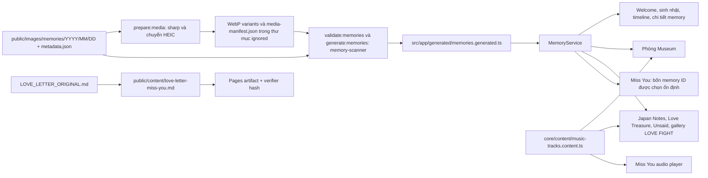

# Sơ đồ dự án

## Runtime và quyền sở hữu route

`src/main.ts` khởi động `AppComponent` và Angular Router. `src/app/app.routes.ts` lazy-load các standalone page. `AppComponent` quản lý header, footer và router outlet dùng chung; `SITE_CONFIG` và `BirthdayJourneyService` cung cấp cấu hình site và trạng thái hành trình.

| Route | Điểm vào | Trách nhiệm và liên kết |
| --- | --- | --- |
| `/` | `features/home/home.page.ts` | Màn chào; `SiteEntryService` ghi nhận lần vào trong session và chuyển người đã quay lại tới `/events`. |
| `/events` | `features/events/events.page.ts` | Hub lấy nội dung từ `core/content/hub.content.ts`, liên kết sinh nhật, LOVE FIGHT và Museum. |
| `/birthday/home` | `features/birthday/birthday-home.component.ts` | Trang sinh nhật, lời chúc, bánh và ảnh lấy từ `MemoryService`. |
| `/birthday` | `features/birthday/birthday.page.ts` → `birthday-experience.component.ts` | Hành trình chúc mừng → quà → phong thư → lá thư; dùng ảnh kỷ niệm, trạng thái journey và các liên kết ẩn tới `/japan-notes`, `/love-treasure`, `/unsaid`. |
| `/timeline` | `features/timeline/timeline.page.ts` → `timeline.component.ts` | Duyệt kỷ niệm theo năm/tháng, thẻ ảnh, media bonus/chưa phân loại và photo viewer. |
| `/memory/:id` | `features/memory-detail/memory-detail.page.ts` | Bài viết cho một kỷ niệm, media liên quan, viewer và điều hướng kỷ niệm trước/sau. |
| `/japan-notes` | `features/japan-notes/japan-notes.page.ts` | Năm chương ghi chú chuyến đi và chăm sóc; dùng ảnh kỷ niệm cùng reveal-on-scroll. |
| `/love-treasure` | `features/love-treasure/love-treasure.page.ts` | Trải nghiệm ảnh kỷ niệm responsive và khu nghe nhạc nội bộ. |
| `/unsaid` | `features/unsaid/unsaid.page.ts` | Tám lời nhắn và phần kết; nội dung riêng kết hợp một luồng ảnh kỷ niệm. |
| `/hint/miss-you` | `features/miss-you/miss-you.page.ts` (guarded) | Trang secret; đọc thư tĩnh nguyên văn, đếm ngày theo ngày lịch `Asia/Ho_Chi_Minh`, gallery ảnh tim từ `MemoryService`, dùng player nhạc chung. Gate trong `sessionStorage` chỉ tạo bất ngờ, không bảo vệ dữ liệu. |
| `/museum` | `features/museum/museum.page.ts` | Phòng trưng bày Three.js dựng từ memory; môi trường procedural, model khách tham quan CC0, hội thoại, âm thanh và photo viewer dùng chung. |
| `/love-fight` | `features/love-fight/love-fight.page.ts` | Trang Angular quản lý setup/HUD/gallery và game engine Phaser 4; session, luật chơi, asset/âm thanh nội bộ và ảnh thật trong ending. |
| `**` | `features/not-found/not-found.page.ts` | Trang không tìm thấy route, có ambient memory media dùng chung. |

Trang chào gốc dùng `SiteEntryService`; chơi lại hành trình sinh nhật dùng `BirthdayJourneyService`. Đây là trạng thái `sessionStorage`, không phải lưu phía server.

## Luồng dữ liệu memory và media

- `scripts/lib/memory-scanner.mjs` là nguồn quy tắc cho manifest: kiểm tra thư mục theo ngày, metadata tùy chọn, ID/ảnh cover, media unresolved, biến thể và kích thước.
- `scripts/generate-media-variants.mjs` tạo ảnh WebP `-thumb`, `-display`, `-medium` cùng metadata kích thước trong `public/images/generated/memories/`, thư mục bị ignore.
- `scripts/generate-memory-index.mjs` ghi `src/app/generated/memories.generated.ts`. Đây là output sinh tự động, không phải nơi sửa dữ liệu.
- `scripts/migrate-memory-images.mjs` chuyển file nguồn vào thư mục theo ngày hoặc unresolved dựa trên EXIF. Đây là lệnh migration media, không thuộc build thông thường.
- `MemoryService` là facade runtime cho index sinh tự động. Các hàm của nó tạo nhóm năm/tháng, ảnh giới thiệu, pool ảnh và phòng Museum. Đổi model hoặc generator có thể ảnh hưởng mọi consumer kể trên.
- Miss You chỉ chọn bốn ID có thật từ danh sách `MemoryService`; thumbnail/display/medium vẫn do pipeline tạo. Không thêm bản sao ảnh memory hoặc sửa index sinh tự động.
- `examples/metadata.example.json` và `docs/ADD_MEMORY.md` hướng dẫn thêm memory; nếu hướng dẫn khác với scanner hiện hành, kiểm tra hành vi scanner.

## Miss You / nội dung tĩnh

- `app.routes.ts` đặt `missYouGuard` tại `/hint/miss-you`. Nếu tab chưa mở gate, guard đưa về `/` với query tạm; `welcomeGuard` cho phép Home render để mở dialog rồi query được xóa bằng replace.
- `MissYouGateService` chỉ lưu flag vào `sessionStorage` theo tab. `HyeuQ` ở client code là Easter egg công khai, không phải xác thực.
- `LOVE_LETTER_ORIGINAL.md` được copy byte-for-byte vào `public/content/love-letter-miss-you.md`. `letter-parser.ts` chỉ chia segment `**bold**`; template Angular render text binding an toàn. `miss-you-content.test.mjs` và `verify-static-artifact.mjs` so hash, byte size và dòng.
- `days-apart.ts` tính ngày lịch VN và delay tới nửa đêm VN; page cập nhật khi timer tới hạn, mỗi phút cho clock hiển thị và khi tab resume.
- `music-tracks.content.ts` là catalog chung. Museum giữ tên alias `MUSEUM_TRACKS`; Love Treasure chỉ thêm adapter duration đang đo trong media element. Miss You tạo một audio element và dừng nó khi route bị destroy.
- Background mới là `public/images/illustrations/miss-you-autumn.webp` (WebP 1600×900, 206,632 bytes); CSS gradient là fallback. Gallery dùng `PhotoViewerComponent` để giữ keyboard/touch/focus behavior dùng chung.

## UI dùng chung và style toàn cục

- `shared/components/media-frame` chọn cách hiển thị ảnh/video và responsive media source.
- `shared/components/photo-viewer` quản lý fullscreen, bàn phím/swipe, video, khôi phục focus và dọn tài nguyên khi đóng viewer.
- `memory-card`, `memory-wall`, `ambient-photo-gallery` và `reveal-on-scroll.directive` được nhiều route dùng lại. Sửa chúng có thể tác động rộng tới giao diện hoặc tương tác.
- `angular.json` nạp `src/styles.scss` trước `src/styles/redesign.scss`; đổi global style có thể ảnh hưởng mọi route. Kiểm tra responsive, vùng chạm và trạng thái reduced-motion.
- Nội dung và model nằm trong `core/content`, `core/constants`, `core/models`; giữ nội dung/cấu hình riêng với template khi cấu trúc hiện tại đã làm như vậy.

## Các subsystem tương tác

### Museum / Three.js

`MuseumPage` lấy phòng từ `MemoryService`, sau đó phối hợp audio player, `MuseumSceneComponent` và `PhotoViewerComponent`. Quy tắc layout, mô phỏng/hội thoại khách tham quan và định nghĩa asset được tách module. `public/museum-assets/manifest.json`, `ATTRIBUTIONS.md`, JSON procedural và GLB Kenney CC0 mô tả tài sản cùng nguồn gốc. Giữ giới hạn texture, đám đông, hàng ảnh trên tường và reduced-motion; Museum có test riêng cho asset và tối ưu hóa.

### LOVE FIGHT / Phaser

`LoveFightPage` quản lý setup, điều khiển hỗ trợ accessibility, HUD, ending và gallery memory. `LoveFightGame` tạo `LoveFightScene`; các module engine tách combat/hitbox, chuyển động, input, combo, camera, projectile, AI, animation và VFX pool. Session/audio service nối game với Angular signals và asset nội bộ. `public/games/love-fight/manifest/runtime.manifest.json` và `data/love-fight-assets.ts` là catalog asset runtime. `LOVE_FIGHT_ASSET_PACK_v1` là tài liệu/asset tham khảo và bị loại khỏi bundle. Đường dẫn `public/games/sf2.zip` hiện chứa trang HTML challenge, không phải ZIP; app không dùng và build loại theo path.

## Nguồn sự thật và file sinh tự động

Khi thông tin khác nhau, ưu tiên theo thứ tự: mã ứng dụng và executable config hiện tại → tests/workflow/manifest → tài liệu hướng dẫn còn hiệu lực → kế hoạch cũ và ghi chú context trước đây. Hãy kiểm tra hành vi trước khi coi kế hoạch cũ là quy tắc hiện hành.

| Phần việc | Điểm cần xem xét về tác động |
| --- | --- |
| Route hoặc thẻ hub | `app.routes.ts`, `hub.content.ts`, điều hướng route, SPA fallback và Playwright coverage tương ứng. |
| Trang secret Miss You | `app.routes.ts`, Home gate, app header, `features/miss-you`, letter source/copy, shared track catalog, `MemoryService`, `PhotoViewerComponent`, unit/E2E và artifact verifier. |
| Cấu trúc memory, metadata hoặc variant pipeline | Scanner, media scripts, memory model, index sinh tự động, `MemoryService`, mọi consumer và artifact verifier. |
| Component media/viewer dùng chung | Mọi route import component bị ảnh hưởng; kiểm tra bàn phím, touch, focus, video và responsive E2E. |
| Hành trình/nội dung sinh nhật | Birthday page/experience, journey service, config/content, đường dẫn ẩn và E2E flow. |
| Asset, layout hoặc crowd Museum | Museum page/scene/layout/crowd modules, định nghĩa asset, manifest/attribution và focused tests. |
| Combat/UI/asset LOVE FIGHT | Page, Phaser engine, session/luật, catalog dữ liệu, asset nội bộ, unit contract và desktop/mobile E2E. |
| Global style hoặc responsive token | App shell và mọi route; kiểm tra desktop/mobile và reduced motion. |
| Base path hoặc static output Pages | `package.json`, `angular.json`, static preparation/verifier scripts, workflow và refresh trực tiếp route con. |

## Toolchain và sơ đồ kiểm tra

- Angular 22, TypeScript strict mode, Node `>=22.22.3`, npm; phiên bản và lệnh nằm trong `package.json`/`package-lock.json`.
- Node built-in tests nằm trong `test/`: memory scanner, Museum asset/tối ưu hóa và LOVE FIGHT contract.
- Node built-in tests nằm trong `test/`: memory scanner, Museum asset/tối ưu hóa, LOVE FIGHT contract và `miss-you-content.test.mjs`.
- Playwright E2E có `e2e/our-story.spec.ts` hiện hữu và `e2e/miss-you-secret-page.spec.ts` riêng; cấu hình viewport desktop Chromium và mobile trong `playwright.config.ts`.
- `npm start` chạy prestart để tạo media và memory index; E2E gọi lệnh này khi khởi động web server.
- Xem [GITHUB_PAGES.md](GITHUB_PAGES.md) để biết quy trình build Pages và quy tắc artifact.
